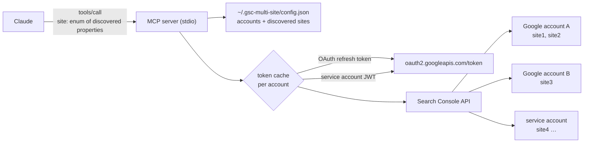

# Google Search Console Multi-Site Connector for Claude

[](https://github.com/JuicedSystems/claude-gsc-multi-site/actions/workflows/ci.yml)
[](LICENSE)
[](https://nodejs.org/)
[](https://modelcontextprotocol.io/)
[](mcp/package.json)

Connect **any number of Google accounts** — and every Search Console property they can see —
through **one** connector. No more disconnecting one Google account to connect another.

```text
You:     How are all my sites doing this month?
Claude:  → all_sites_summary { "days": 28 }
         Across 6 sites: 18,420 clicks (+12.4%) and 612k impressions (+8.1%) vs the prior 28 days.
         kegsmiths.com led the gain (+31% clicks) …

You:     Top non-branded queries for phoenixputter.com, mobile only.
Claude:  → search_analytics { "site": "phoenixputter.com", "dimensions": ["query"],
             "filters": [ { "dimension": "query", "operator": "notContains", "expression": "phoenix" },
                          { "dimension": "device", "expression": "MOBILE" } ] }

You:     Is https://kegsmiths.com/products/mini-keg indexed?
Claude:  → inspect_url { "site": "kegsmiths.com", "url": "https://kegsmiths.com/products/mini-keg" }
```
<sub>Illustrative transcript. Tool names and arguments match the real schema.</sub>

## Features

- **Many Google accounts, one connector.** Sign in with as many Google accounts as you like (or add
  service accounts). The server discovers every property each one can see and merges them into one list.
- **The site guardrail.** Every site tool has a required `site` argument whose JSON-schema `enum` is your
  discovered properties. Claude can't skip naming a site and can't invent one. Connecting an account
  updates the list live — no restart.
- **All sites in one call.** `all_sites_summary` returns clicks, impressions, CTR and position for every
  property, with % change vs the previous period.
- **Smart de-duplication.** A property visible to several accounts is listed once and read through the
  account with the highest permission. Domain properties get the bare domain as their alias
  (`phoenixputter.com`); URL-prefix properties get the host (`www.juicedsystems.com`). Rename or hide any.
- **Sign-in from chat.** `connect_google_account` returns a Google link; approve it in your browser and
  the account is saved (OAuth installed-app flow with PKCE and a one-shot `127.0.0.1` listener).
- **Read-only by default.** Accounts connect with `webmasters.readonly`. Opt into `full` per account only
  if you want Claude to submit or remove sitemaps.
- **No dependencies.** Plain Node 18+ — `fetch`, `crypto` and `http` built-ins. Service-account JWTs are
  signed with Node's own RSA. No `npm install`, no `node_modules`.

## Quickstart

### 1. Install

```bash
/plugin marketplace add JuicedSystems/claude-gsc-multi-site
/plugin install gsc-multi-site@juiced-systems-gsc
/reload-plugins
```

> Needs Node.js 18+ on your PATH. Developing locally? `/plugin marketplace add ./claude-gsc-multi-site`.

### 2. One-time Google Cloud setup (≈5 minutes)

1. [console.cloud.google.com](https://console.cloud.google.com) → create a project (e.g. "Claude GSC").
2. **APIs & Services → Library** → enable **Google Search Console API**.
3. **OAuth consent screen**: External, add your app name/email. Set publishing status to
   **In production**. ⚠️ If you leave it in *Testing*, Google expires refresh tokens after **7 days**
   and you'll have to reconnect weekly. An unverified app is fine for your own use — click
   *Advanced → Go to … (unsafe)* on the warning.
4. **Credentials → Create credentials → OAuth client ID → Desktop app.** Copy the Client ID and
   Client secret (`GOCSPX-…`).

One OAuth client connects **all** your Google accounts — you only do this once.

### 3. Connect your accounts

Run **`/gsc-setup`** and follow along, or just say:

> Connect my Google Search Console account. Client ID is … and secret is …

Claude gives you a sign-in link → pick the Google account → the tab says *Connected* → done.
Repeat for every other Google account (no client needed after the first).

Then try **`/gsc-sites`** or **`/gsc-report`**.

### Alternative: service accounts

For properties you can't sign into (a client's site, say): create a service account in Google Cloud,
download its JSON key, and have the property owner add the service account's email as a user in
**Search Console → Settings → Users and permissions**. Then:

> Add the service account at C:\Users\Dylan\.gsc-multi-site\agency-sa.json as "agency-sa".

## Tools

| Tool | Access | What it does |
|---|---|---|
| `list_sites` | — | Every property: alias, siteUrl, type, account, permission |
| `list_accounts` | — | Connected accounts and sign-in status |
| `connect_google_account` | setup | Start a Google sign-in (returns the link) |
| `finish_google_account` | setup | Fallback: paste the redirect URL if the local page didn't load |
| `add_service_account` | setup | Connect a service-account JSON key |
| `refresh_sites` | setup | Re-discover properties (new ones added, lost ones dropped) |
| `update_site` | setup | Rename an alias, set a label, hide/unhide |
| `remove_account` | setup | Disconnect an account and delete its saved credentials |
| `all_sites_summary` | read | Totals + period-over-period change for every site |
| `search_analytics` | read | Full Search Analytics query: dimensions, filters, search type, paging |
| `performance_summary` | read | One site: totals vs previous period + top queries & pages |
| `inspect_url` | read | URL Inspection: index status, canonical, crawl, mobile, rich results |
| `list_sitemaps` | read | Submitted sitemaps with errors/warnings |
| `submit_sitemap` | **write** | Submit/resubmit a sitemap (account needs `full`) |
| `delete_sitemap` | **write** | Remove a submitted sitemap (account needs `full`) |

Dates are Pacific Time (as in Search Console). By default windows end 3 days ago, because Search
Console data lags 2–3 days; pass `dataState: "all"` to `search_analytics` for fresher partial data.

## How it works



1. Each account is either an OAuth refresh token or a service-account key. Access tokens are minted on
   demand, cached, and refreshed about 2 minutes before they expire.
2. Connecting or refreshing an account calls `sites.list` and merges the result into `config.json`
   (keeping your aliases, labels and hidden flags), then rewrites the `site` enum on every tool and sends
   `notifications/tools/list_changed`.
3. A tool call looks up the site, picks the account that reads it, and calls the API.

## Configuration

`~/.gsc-multi-site/config.json` (Windows: `C:\Users\<you>\.gsc-multi-site\config.json`) is written by
the tools; you rarely need to touch it. See [`config.example.json`](config.example.json).
Override the location with `GSC_MULTI_SITE_CONFIG`.

| Field | Notes |
|---|---|
| `oauthClient.clientId / clientSecret` | Your Desktop-app OAuth client, shared by all OAuth accounts |
| `accounts[].type` | `oauth` (refreshToken) or `service_account` (keyFile) |
| `accounts[].access` | `readonly` (default) or `full` |
| `sites[].alias` | The value Claude passes as `site`. Editable; survives refreshes |
| `sites[].label` / `hidden` | Friendly name / exclude from the list and all-sites summary |
| `sites[].alsoIn` | Other accounts that can also see this property (fallback if one is removed) |

## Data & network access

Everything the plugin runs, sends and stores:

| What | Where | Why |
|---|---|---|
| Runs | `node ${CLAUDE_PLUGIN_ROOT}/mcp/server.js` (stdio MCP server, readable source, no dependencies, nothing downloaded at install or run time) | The connector itself |
| Sends to `https://oauth2.googleapis.com/token` | OAuth client ID/secret + refresh token, or a service-account JWT signed locally | To get short-lived access tokens |
| Opens `https://accounts.google.com/o/oauth2/v2/auth` | Only as a link you click, during `connect_google_account` | Google sign-in |
| Sends to `https://searchconsole.googleapis.com` | Your Search Console queries (dates, dimensions, filters, URLs to inspect, sitemap URLs) | The Search Console API |
| Listens on `http://127.0.0.1:<random port>` | Only while a sign-in is pending (max 10 minutes, one request) | Receives Google's sign-in redirect |
| Stores | `~/.gsc-multi-site/config.json` on your machine: OAuth client, refresh tokens, service-account key *paths*, discovered site list | So you only connect once |
| Reads | Service-account key files at the paths you give it | To sign the service-account JWT |

Nothing is sent anywhere else: no telemetry, no analytics, no third-party servers. Search Console data
goes only to Claude as tool results. The environment variables `GSC_TOKEN_URL`, `GSC_AUTH_URL` and
`GSC_API_BASE` exist only so the test suite can point the server at a local mock; they are unset in
normal use, and `GSC_MULTI_SITE_CONFIG` only moves the config file.

## Security

- `config.json` holds refresh tokens. Keep it off shared machines and out of git (`.gitignore` covers it).
  On macOS/Linux the server writes it with `0600` permissions.
- Tools never echo secrets; `list_sites` / `list_accounts` return names, emails and URLs only.
- The sign-in listener binds to `127.0.0.1` only, uses PKCE and a random `state`, accepts one
  callback, and closes after 10 minutes.
- `remove_account` deletes local credentials; also revoke the app at
  [myaccount.google.com/permissions](https://myaccount.google.com/permissions) to cut it off fully.

## Troubleshooting

- **`invalid_grant` after about a week** — your OAuth consent screen is in *Testing*. Switch it to
  *In production* and reconnect the account.
- **"Google Search Console API has not been used in project …"** — enable the API in the same project
  as your OAuth client, wait a minute, retry.
- **A property is missing** — the account needs a verified Owner/Full/Restricted permission on it
  (unverified properties are skipped). Then `refresh_sites`.
- **Service account sees no sites** — add its email as a user on each property in Search Console.
- **"read-only" on a sitemap write** — reconnect that account with access `full`.
- **Sign-in tab can't load `127.0.0.1`** — the browser is on a different machine than Claude. Copy the
  URL from the address bar and ask Claude to finish with it (`finish_google_account`).

## Development

```bash
cd mcp
npm test   # syntax check + offline smoke test + end-to-end test against a local mock of Google
```

The end-to-end test runs a mock token endpoint and Search Console API, verifies the service-account
JWT signature, walks the full loopback sign-in, and checks discovery, merging, analytics, the
all-sites summary, URL inspection, the write guard, renaming and removal. CI runs it on Node 18/20/22.

## License

[MIT](LICENSE) © 2026 Juiced Systems · Built by **Dylan Smith** / [Juiced Systems](https://github.com/JuicedSystems) · [dielawn.com](https://dielawn.com)
