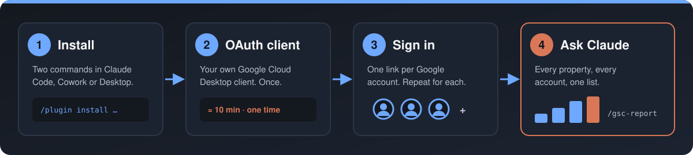

# Setup guide

From a fresh install to every Search Console property you own answering in Claude.

<p align="center"></p>

**Time:** about 10 minutes the first time, then about 30 seconds per extra Google account.
**Cost:** free. The Search Console API has no charge, and nothing is hosted.

- [Before you start](#before-you-start)
- [Step 1 — Install the plugin](#step-1--install-the-plugin)
- [Step 2 — Create your Google OAuth client](#step-2--create-your-google-oauth-client-one-time)
- [Step 3 — Connect your first Google account](#step-3--connect-your-first-google-account)
- [Step 4 — Connect your other Google accounts](#step-4--connect-your-other-google-accounts)
- [Step 5 — Try it](#step-5--try-it)
- [Managing sites](#managing-sites)
- [Option — Service accounts](#option--service-accounts)
- [Updating, disconnecting and uninstalling](#updating-disconnecting-and-uninstalling)
- [Troubleshooting](#troubleshooting)
- [FAQ](#faq)

## Before you start

You need:

- **Node.js 18 or newer** on your PATH. Check with `node --version`; install from <https://nodejs.org>.
- **Claude Code, Cowork or the Claude desktop app.** The plugin runs a small program on your computer,
  so it doesn't run in the claude.ai web or mobile apps.
- **One website you own that's verified in Search Console.** Google wants your OAuth app's home page
  and privacy page to live on a domain you own. If you use Search Console, you already have one.
- **About 10 minutes** for the one-time Google Cloud setup.

## Step 1 — Install the plugin

In Claude:

```text
/plugin marketplace add JuicedSystems/claude-gsc-multi-site
/plugin install gsc-multi-site@juiced-systems-gsc
/reload-plugins
```

Check it's running by asking: *"List my Search Console accounts."* Claude should answer that none are
connected yet.

## Step 2 — Create your Google OAuth client (one time)

The plugin signs in to Google with an OAuth client that **you** own, so your Google access never passes
through anyone else's app or server. One client works for all your Google accounts.

Sign in to <https://console.cloud.google.com> with any of your Google accounts. A personal Gmail is
fine even if your properties belong to Workspace accounts.

### 2a. Create a project and enable the API

1. Click the project picker at the top left → **New project**. Name it `Claude GSC` → **Create**.
2. Make sure the new project is selected in the picker.
3. Go to **APIs & Services → Library**, search **Google Search Console API**, open it → **Enable**.

### 2b. Set up Google Auth Platform

1. Search the top bar for **Google Auth Platform** and open it → **Get started**.
2. **App information:** App name `Claude GSC`, User support email: yours → **Next**.
3. **Audience:** **External** → **Next**.
   Choose External even if your accounts are Google Workspace accounts. *Internal* only allows accounts
   in the one Workspace that owns the project.
4. **Contact information:** your email → **Next**.
5. Agree to the Google API Services User Data Policy → **Continue** → **Create**.

### 2c. Add your home page and privacy link (unlocks Publish)

Google won't let you publish the app until Branding has a home page, a privacy policy link and an
authorized domain. Use a website you own.

1. Go to **Branding**.
2. **Application home page:** your site, e.g. `https://yoursite.com`
3. **Application privacy policy link:** a page on the same site, e.g.
   `https://yoursite.com/claude-gsc/privacy`. Create that page with the
   [template below](#privacy-page-template) if you don't have one.
4. **Authorized domains → Add domain:** `yoursite.com`
5. Leave **App logo** and **Terms of service** empty. Uploading a logo makes Google require a formal
   verification review.
6. **Save**.

> Only you ever see this consent screen, so the site doesn't need to be anything special: your
> portfolio or any business site you own works.

### 2d. Publish the app

1. Go to **Audience** → **Publish app** → **Confirm**.
2. Publishing status should now read **In production**.

> **Why publish?** In *Testing*, Google expires sign-ins after 7 days and only allows listed test users,
> so you'd reconnect every week. Publishing doesn't list your app anywhere; it only removes those limits.
> Google may show "unverified app" warnings, which is expected for your own client and fine for up to
> 100 users.

If **Publish app** stays greyed out with "complete your configuration on the Branding page", recheck
step 2c: all three fields must be filled and saved.

### 2e. Create the Desktop client

1. Go to **Clients** → **Create client**.
2. **Application type:** **Desktop app**. Not *Web application*; that type rejects the plugin's
   sign-in redirect.
3. Name it `Claude GSC desktop` → **Create**.
4. Copy the **Client ID** (ends in `.apps.googleusercontent.com`) and **Client secret** (starts with
   `GOCSPX-`). Click **Download JSON** too: Google may not show the secret again.

## Step 3 — Connect your first Google account

Run `/gsc-setup`, or tell Claude:

> Connect my Google Search Console account. Client ID is `…apps.googleusercontent.com`, secret is `GOCSPX-…`.

Claude saves the client on your computer and replies with a **sign-in link**. Then:

1. **Open the link** (it expires in 10 minutes).
2. **Choose one Google account**, the one that owns or can see your Search Console properties.
3. On **"Google hasn't verified this app"**, click **Advanced → Go to Claude GSC (unsafe)**.
   It's your own app.
4. **Approve** read-only access to Search Console.
5. One of two things happens:
   - **The tab says "Connected to Claude".** Done; go back to Claude.
   - **The tab says "This site can't be reached".** This is normal when your browser and the plugin
     run on different machines, or when the desktop app relays to your computer. **Copy the entire
     address from the address bar** (it starts with `http://127.0.0.1:` and contains `code=`) and
     **paste it into Claude**. Claude finishes the sign-in with it. Do this within a few minutes.

Claude replies with the account it connected and the properties it found.

## Step 4 — Connect your other Google accounts

Say *"Connect another Google account"*. Claude gives you a fresh link. In Google's account chooser pick a
**different** account (or **Use another account**), then repeat steps 3–5 above. No new client is needed.

Repeat for every account. All their properties merge into one list:

- A property shared with several of your accounts is listed once, read through the account with the
  highest permission.
- **Duplicates are hidden automatically.** If an account has a Domain property (`yoursite.com`) and
  URL-prefix properties inside it (`https://www.yoursite.com/`), the URL-prefix ones are hidden so
  all-sites totals don't count the same clicks twice. Unhide any of them in [Managing sites](#managing-sites).

## Step 5 — Try it

| Ask Claude | What it uses |
|---|---|
| "How are all my sites doing this month vs last month?" | `all_sites_summary` |
| `/gsc-report` or `/gsc-report 90` | Cross-site report with biggest movers |
| "Give me a report card for yoursite.com" | `performance_summary` |
| "Top non-branded queries for yoursite.com on mobile, last 90 days" | `search_analytics` with filters |
| "Which pages lost the most clicks this quarter?" | `search_analytics` by page, two windows |
| "Is https://yoursite.com/some-page indexed? What canonical did Google pick?" | `inspect_url` |
| "List the sitemaps for yoursite.com and any errors" | `list_sitemaps` |

Search Console data lags 2–3 days, so reports end 3 days ago by default. Dates are Pacific Time, like
Search Console itself.

## Managing sites

| Say to Claude | What happens |
|---|---|
| `/gsc-sites` | Lists every connected site, and any hidden ones |
| "Rename www.yoursite.com to blog" | Changes the name Claude uses for it |
| "Label yoursite.com as My Store" | Adds a friendly label shown in reports |
| "Hide old-site.com" / "Unhide www.yoursite.com" | Removes it from, or returns it to, the list and all-sites reports |
| "Refresh my Search Console sites" | Picks up properties you added and drops ones you removed or lost access to. Keeps your names, labels and hidden choices |

## Option — Service accounts

For properties owned by someone you can't sign in as, such as a client:

1. Google Cloud Console (same project is fine) → **IAM & Admin → Service Accounts → Create service
   account**. No roles are needed.
2. Open it → **Keys → Add key → Create new key → JSON**. Save the file somewhere private.
3. The property owner adds the service account's email (`…@….iam.gserviceaccount.com`) in **Search
   Console → Settings → Users and permissions → Add user** (Restricted for read-only, Full for sitemaps).
4. Tell Claude: *"Add the service account at C:\Users\you\.gsc-multi-site\client-sa.json as client-sa."*

## Updating, disconnecting and uninstalling

- **Update:** `/plugin marketplace update juiced-systems-gsc`, then `/reload-plugins`. Your connected
  accounts and settings are kept.
- **Disconnect one account:** *"Remove the Google account you-example.com from the Search Console
  connector,"* then revoke the app at <https://myaccount.google.com/permissions>.
- **Remove everything:** `/plugin uninstall gsc-multi-site` and delete the `.gsc-multi-site` folder in
  your home directory.

## Troubleshooting

| Symptom | Fix |
|---|---|
| **Publish app** is greyed out | Branding needs a home page, a privacy policy link and an authorized domain (step 2c). Save, then reload Audience |
| "This site can't be reached" after approving | Expected in some setups. Paste the full `http://127.0.0.1:…` address into Claude (step 3.5) |
| "Access blocked: … has not completed the Google verification process" | The app is still in *Testing* and this account isn't a test user. Publish it (step 2d) |
| "Access blocked: your administrator…" / `admin_policy_enforced` | A Google Workspace admin blocks unverified apps. In the Admin console: **Security → Access and data control → API controls → Manage third-party app access**, add the app by its Client ID and set it to **Trusted** |
| `invalid_grant` after about a week | The app was in *Testing* when you connected. Publish it, then reconnect the account |
| "Search Console API has not been used in project…" | Enable the API (step 2a) in the same project as the client. Wait a minute, retry |
| `redirect_uri_mismatch` | The client isn't a **Desktop app**. Create a Desktop client (step 2e) |
| A property is missing | The account needs a verified Owner, Full or Restricted permission on it. Unverified properties are skipped. Then "Refresh my Search Console sites" |
| A property you expected is hidden | It's a URL-prefix property inside a Domain property. Say "unhide …" |
| Service account sees nothing | The owner hasn't added its email to the property yet |
| "read-only" when submitting a sitemap | Reconnect that account and say "with full access" |
| Google returned no refresh token | Remove the app at <https://myaccount.google.com/permissions> and connect again |

## FAQ

**Do I need to host a server?** No. The plugin runs on your computer. The only web pages involved are
the home page and privacy page on your own site, which Google requires for your OAuth app.

**Who can see my data?** Only you and Claude. The plugin talks to Google directly from your computer and
stores your sign-ins only in `~/.gsc-multi-site/config.json`. Nothing goes to the plugin's author. See
[PRIVACY.md](../PRIVACY.md).

**Why do I create my own Google client?** So your access to Google stays between you and Google. A shared
client would route everyone's sign-ins through one developer's app.

**Can I skip publishing and use test users?** Yes: on **Audience**, add your Google accounts under
**Test users** and leave the app in Testing. Sign-ins then expire every 7 days, so you'd reconnect each
account weekly.

**How many accounts and sites can I connect?** As many as you like. Google lets an unverified app sign
in up to 100 distinct Google accounts.

**Is it safe to give Claude my client secret?** It's saved only in your local config file. A desktop
client secret alone can't access your data without a sign-in on your machine. If it's ever exposed, reset
it in Google Cloud → Clients and reconnect your accounts.

### Privacy page template

Put this at the privacy URL you entered in step 2c (edit the bracketed parts):

```markdown
# Privacy policy — Claude GSC ([your name or company])

This OAuth app is used only by [your name] to read their own Google Search Console data in Claude
through the open-source Search Console Multi-Site Connector
(https://github.com/JuicedSystems/claude-gsc-multi-site).

- It requests read-only access to Search Console (and, if chosen, sitemap management) plus your email
  address to label the connected account.
- Sign-in tokens are stored only on the user's own computer. No data is sent to [your name] or any
  third party; Search Console data goes only to Google and to the user's Claude app.
- Use of information received from Google APIs adheres to the Google API Services User Data Policy,
  including the Limited Use requirements.
- To revoke access, visit https://myaccount.google.com/permissions.

Contact: [your email]
```
